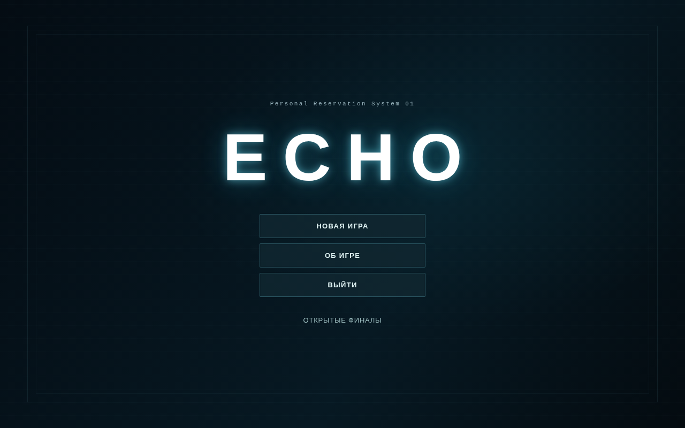
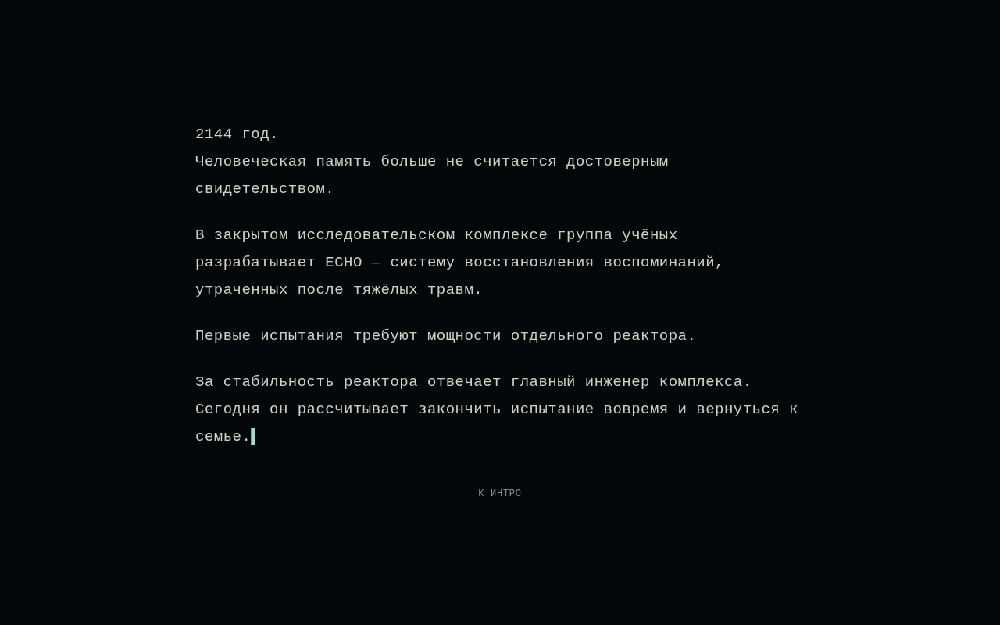
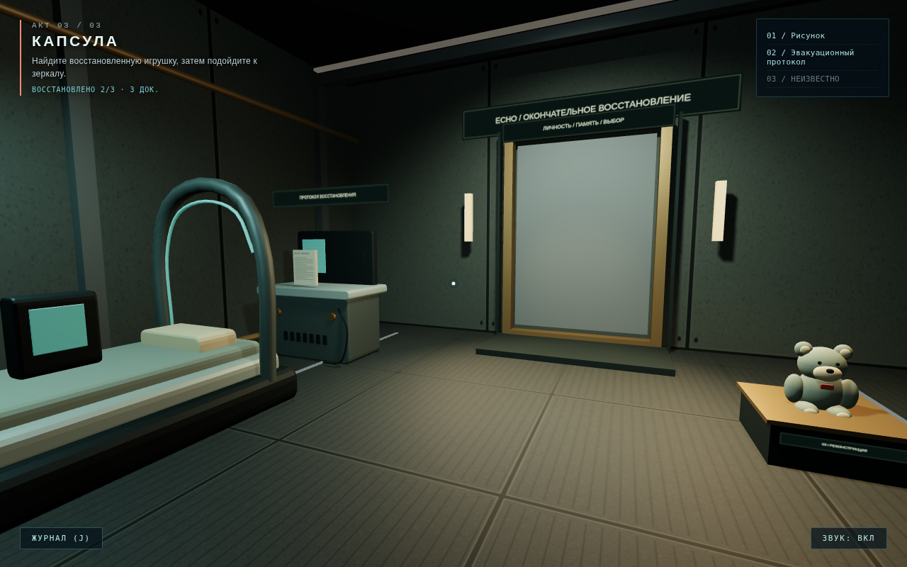

# ECHO

Психологическая игра от первого лица о памяти и ответственности. После аварии
главный инженер восстанавливает события по личным предметам и повреждённым
документам. Судьба семьи остаётся неизвестной во всех финалах.

## Запуск

Распакуйте проект и запустите `start_game_windows.bat` на Windows (нужен Python 3).
Или выполните из папки проекта:

```sh
python -m http.server 8765
```

Откройте игру в браузере через локальный HTTP-сервер. Открытие `index.html`
через `file://` не поддерживается. Библиотеки, модели и звук поставляются
локально; интернет для прохождения не нужен.

## Главное меню



В меню остаются Personal Reservation System 01, ECHO и кнопки. Оформление —
оригинальная технологическая рамка, тёмная замутнённая панель и локальный
шрифт Jura с кириллицей. В обычном состоянии кнопки текстовые, капсом;
при наведении или фокусе с клавиатуры появляется мягкая подсветка.
«Открытые финалы» — текстовая кнопка, открывающая галерею всех трёх концовок.
Слева показана финальная картинка, справа — название и полное описание.
Неоткрытые концовки доступны для чтения с прозрачностью 50%; открытые — 100%.

- **Новая игра** — показывает предысторию с эффектом печатной машинки, затем исходное интро и первый акт. Ранее полученные финалы сохраняются.
- **Продолжить** — видна всегда, но до первого полученного финала неактивна.
  После первого прохождения возвращает в сохранённый акт, позицию и направление взгляда.
- **Вернуться к развилке** — тоже видна всегда и заблокирована до первого финала.
  Дополнительно требуется сохранённая контрольная точка. Поздний прогресс ветки
  сбрасывается, открытые финалы остаются.
- **Об игре** — отдельный экран с краткой аннотацией и ссылкой на авторов ассетов.

Неактивные кнопки имеют прозрачность 50%, не подсвечиваются и не реагируют
на нажатия. Кнопка «Выйти» удалена. Окна документов и выборов оформлены в
стиле главного меню, с такими же текстовыми кнопками. Внутренних полос
прокрутки нет; длинные окна остаются доступны прокруткой внешнего слоя.

Сохранения находятся в localStorage браузера и привязаны к адресу игры.
Автосохранение работает во время прохождения, при возврате в меню, смене
видимости страницы и закрытии вкладки. Старые сохранения до введения первого
выбора, дошедшие до третьего акта, возвращаются к новой развилке лаборатории.
Ключ `rewrite` в старых данных сохранён как внутренний идентификатор финала
«Стереть»; в интерфейсе прежнее название не используется.

## Управление

WASD / стрелки — движение, мышь — только обзор. Клики по сцене не нужны.
E открывает и закрывает документы, запускает приёмник и подтверждает действия.
В меню и на развилках стрелки (или W/S) выбирают кнопку, E подтверждает выбор.
Этим же способом можно начать игру, продолжить и вернуться в главное меню.
J открывает журнал. E пропускает текст, интро и финальные кат-сцены; если
браузер заблокировал автозапуск видео, E сначала включает воспроизведение.

Escape ставит прохождение на паузу, в том числе документы и кат-сцены.
В меню паузы ровно две кнопки: «Продолжить» и «В главное меню».
Возврат продолжает тот же документ или ролик с остановленного места.
Звук и радиотаймеры приостанавливаются вместе с игрой. Экранное управление
для сенсорных устройств сохранено.

## Два моральных выбора

**Акт 1 — Шлюз.** Найдите рисунок и восстановите передачу на приёмнике.
Перед исходной вступительной кат-сценой показывается согласованная
предыстория о 2144 годе и проекте ECHO. Текст набирается по буквам шрифтом Courier New (с запасным Courier),
между абзацами есть паузы. После последнего символа начинается радиопереход:
короткий шум связи, через 0,5 секунды — новая реплика дочери с радиопомехами,
затем шум обрыва связи. Только после него запускается исходная сирена и
прежнее видео с прежней озвучкой. «Пропустить текст» показывает текст целиком
и запускает радиопереход; «К интро» во время перехода пропускает его.
Само видео по-прежнему можно пропустить отдельно.



**Акт 2 — Лаборатория.** Прочитайте приказ эвакуации и повреждённый реестр.
До этого журнал реактора недоступен. После его чтения и закрытия предлагается:

- «Взять на себя ответственность»;
- «Оправдаться».

Решение сохраняется; игра переходит в третий акт. Перед решением сохраняется
контрольная точка для кнопки возврата к развилке.

**Акт 3 — Капсула.** Документы «Границы восстановления» и «Память и личность»
подводят к завершению, не сообщая судьбу семьи. Найдите игрушку и подойдите
к матовому зеркалу.



Зеркало непрозрачное, с максимальной шероховатостью, без отражения комнаты
или героя. Модель персонажа не создаётся и не показывается во время игры.

| Первый выбор | Доступные финалы |
| --- | --- |
| Ответственность | Принять правду; Создать новую личность |
| Оправдание | Стереть; Создать новую личность |

За одно прохождение предлагаются ровно два варианта. Полученные финалы
отмечаются в галерее «Открытые финалы» и сохраняются между прохождениями.

Авторство внешних ассетов и лицензии: [CREDITS.md](CREDITS.md).
Модели оборудования пересобираются командой `node tools/build-models.mjs`.

## Проверки

```sh
npm test
```

Проверяются сюжет, порядок документов, две ветки, сохранения, концовки,
интерфейс и GLB-файлы оборудования.

Для браузерного теста установите Playwright:

```sh
npm install --no-save --package-lock=false playwright
npx playwright install chromium
npm run test:browser
```

HTTP-сервер игры должен быть запущен отдельно. Переменные `ECHO_TEST_URL`,
`CHROMIUM_PATH` и `ECHO_SCREENSHOTS` задают адрес, путь к браузеру и папку
снимков. Тест проходит обе ветки, получает три финала, проверяет перезагрузку
сохранения, возврат к развилке после первого финала, непрозрачное зеркало без героя, меню и
повторные переходы без накопления геометрий и текстур.


## Фоновая музыка

Предоставленный пользователем трек Remstage Music — In the house in a heartbeat
хранится локально в `assets/background_music.mp3`. Он зациклен и плавно
появляется только после интро, на слышимом фоновом уровне (gain 0.14). Во время
радиозаписи уровень дополнительно снижается до 0.035. В главном меню,
предыстории, интро, паузе и скрытой вкладке воспроизведение приостановлено.
Общий переключатель звука отключает музыку.

Во всех трёх финальных кат-сценах звучит WAY — Make A Wish My Star из меню:
с начала видео песня воспроизводится с отметки 0:16 на том же уровне 0,14.
Музыка следует времени ролика при перемотке, паузе и возврате во вкладку;
при завершении, пропуске или выходе в меню останавливается. Исходная звуковая
дорожка каждого ролика сохранена.


## Звук печатной машинки

Пользовательская запись сохранена в `assets/typewriter.mp3`. Из неё выделено
шесть коротких ударов (`assets/typewriter-keys.wav`). Каждый видимый
непробельный символ запускает один удар в том же обновлении, без
независимого фонового цикла. Темп слегка варьируется; между абзацами
печать молчит. При пропуске предыстории активные звуки останавливаются.
Общий флаг звука отключает и печать.

Для пересборки семплов: `python tools/build-typewriter.py` (нужен ffmpeg).
Оригинальная запись не изменяется. Для воспроизведения ffmpeg не требуется.


## Связка предыстории и интро

Новая пользовательская запись дочери: `assets/prologue_daughter.mp3`.
Программно пропускается только начальная тишина в 214 мс; исходный файл
не изменён. Запуск реплики запланирован по AudioContext на 0,5 секунды
после появления последнего символа. До и после реплики звучат короткие
радиопомехи. Обработка совпадает с «Daddy?» в интро: полоса 680–1750 Гц,
насыщение, квантование и модуляция сигнала 8,5 Гц. Сирена и видео запускаются
после завершения последнего шума; исходная реализация интро не менялась.


## Кнопка пропуска и разбитое стекло

Кнопка «Пропустить» в интро повторяет положение и оформление кнопки
«Пропустить текст»: Courier New, по центру под текстовой областью.
Обе кнопки закреплены по центру внизу, с отступом от безопасной области экрана.

В момент удара стекло распадается на 57 объёмных фрагментов: общие границы
ячеек образуют трещины, затем осколки разлетаются и вращаются по трём осям.
Материал использует преломление, отражения и отдельные скошенные грани.
Картинка и красная подсветка плавно гаснут с 7,55 до 8,50 секунды.
Трещины появляются с 8,52 секунды уже на чёрном фоне; на 8,90 секунды
стекло разбивается, и сразу начинается появление названия ECHO без паузы.
Белой вспышки после стекла нет. Исходные видео и звук сохранены.

Кадр эффекта: [разлёт стекла](docs/glass-shatter.png).


## Объявления локаций и полная передача

При входе в Шлюз, Лабораторию и Капсулу появляется табличка с номером акта
и названием. Она исчезает через две секунды; первый акт объявляется после интро.
У заблокированного журнала реактора подсказка заранее просит изучить два
других документа и меняется после их прочтения.

Приёмник воспроизводит новую реплику целиком — “When are you coming, Daddy?”,
включая исходную начальную паузу. Перед ней, на фоне и после неё звучат
радиопомехи; затем с короткой паузой и дополнительными помехами звучит
прежний фрагмент “Daddy?”, после чего — взрыв и обрыв связи. Русский
субтитр синхронизирован с первой репликой. Закрытие записи останавливает
оба фрагмента и все запланированные звуки.
Закрытие записи останавливает оба фрагмента и запланированные звуки.


## Проверка интерфейса (обновление)

- Кнопка пропуска интро теперь использует тот же нижний центральный якорь и оформление, что и «Пропустить текст» в предыстории.
- Табличка «Акт N. Название» появляется при входе в каждую локацию и исчезает через 2 секунды.
- У заблокированного журнала реактора основная подсказка и короткий дисклеймер отображаются раздельно; после чтения двух предварительных документов дисклеймер исчезает.
- Добавлены автоматические проверки полной реплики в приёмнике, радиопомех, положения кнопок пропуска, двухсекундных объявлений и дисклеймера.


## Final subtitle adjustment
- Receiver captions are Russian-only. The opening line appears at the beginning of the recovered transmission as «Папа, когда ты придёшь?»; the English audio remains unchanged.

- Receiver panel header is Russian-only; the runtime caption renderer strips any legacy English version of the opening subtitle.


## First-line subtitle after the typewriter prologue
- Added a separate Russian subtitle «Папа, когда ты придёшь?» to the daughter’s first radio line immediately after the typewriter text finishes.
- The subtitle appears in sync with the actual voice start (after the radio pre-hiss) and disappears at the end of the voice.
- The English spoken audio is unchanged; no English subtitle is shown.
- Skipping/closing the prologue clears the caption and its scheduled timers.


## Кат-сцена «Принять правду»

После выбора «Принять правду» воспроизводится предоставленный 10-секундный
ролик. Реплика героя встроена в звуковую дорожку с шестой секунды, в момент
закрытия глаз. Начальная пауза записи в 950 мс пропущена; исходная MP3
сохранена без изменений. Фоновая музыка на время кат-сцены приостанавливается.
После окончания или пропуска ролика открывается финальная картинка. E также
пропускает кат-сцену; скрытие вкладки приостанавливает видео вместе со звуком.

Для пересборки дорожки: `python tools/build-ending-accept.py` (нужен ffmpeg).
Для прохождения ffmpeg не требуется.

Проверка кат-сцены в браузере: `npm run test:ending` (тот же Playwright и
запущенный HTTP-сервер, что и для `npm run test:browser`).


## Вторая кат-сцена — «Стереть» (`rewrite`)

Для второй концовки (пользовательское название — «переписать историю»)
подключён ролик `assets/ending_rewrite.mp4`, около 5,2 секунды. Видео и его
исходная звуковая дорожка сохранены без изменений. Кат-сцена запускается после
выбора «Стереть» в ветке оправдания; после просмотра или пропуска показывается
финальная картинка этой концовки. Управление воспроизведением такое же, как в первом ролике.


## Финальные картинки и галерея

После завершения каждой из трёх концовок отображается её картинка и кнопка
«В главное меню» внизу по центру. Подробный текст перенесён в галерею
«Открытые финалы». Неоткрытые записи не заблокированы для чтения: картинка
и описание отображаются с прозрачностью 50%, а чтение не открывает концовку.
На узких экранах описание располагается под картинкой. Кнопка возврата
остаётся внизу экрана при прокрутке галереи.

В первой кат-сцене на реплике “I knew the risk” показан субтитр
«Я знал о риске.» (6,00–7,45 с), привязанный к времени видео.

Проверка галереи: `npm run test:gallery`.


## Третья кат-сцена — «Создать новую личность»

После выбора новой личности в любой из двух моральных веток воспроизводится
предоставленный ролик `assets/ending_restart.mp4` (около 6,1 секунды). Видео и
его звук сохранены без изменений. Фоновая музыка приостанавливается на время
кат-сцены; после просмотра или пропуска появляется карточка START AGAIN
с кнопкой «В главное меню» внизу по центру.


## Размер кат-сцен и переход к картинке

У второго ролика компенсированы встроенные чёрные поля: видимая картинка
занимает ту же ширину, что и в первом ролике. Исходный файл и звук не изменены.
Финальная картинка подготавливается и декодируется за видео. В момент
завершения она сразу видна без затемнения и без кадра 3D-сцены между ними.

Проверка управления и перехода: `npm run test:controls`.


## Титры «Авторы и лицензии»

Кнопка в разделе «Об игре» открывает отдельный экран внутри игры. Титры
двигаются снизу вверх со скоростью 60 пикселей в секунду. Содержимое берётся
из CREDITS.md; авторство, названия ресурсов и ссылки на лицензии сохранены.
Пробел приостанавливает и продолжает титры, стрелки и Page Up/Down позволяют
читать вручную. E или Escape возвращает в «Об игре». При повторном открытии
титры начинаются заново. Скрытая вкладка и закрытый экран не прокручивают текст.


## Вступительная кат-сцена на телефоне

Интро целиком помещается в экран с сохранением горизонтальных пропорций 16:9.
На вертикальном телефоне ролик занимает всю ширину, а сверху и снизу остаются
свободные поля; центральная область больше не увеличивается с обрезкой краёв.
При повороте телефона размер кадра пересчитывается, вместе с ним масштабируются
трещины и осколки. Начальный статичный кадр отображается по тем же правилам.

Проверка: `npm run test:intro-layout`.


## Музыка главного меню

Пользовательская песня WAY — Make A Wish My Star хранится локально в
`assets/menu_music.mp3` и зациклена в главном меню, «Об игре», галерее и титрах.
При начале или продолжении игры она останавливается. Громкость — 0,14, как
у фоновой музыки в игре, с плавным появлением. Общая кнопка звука
в меню отключает и включает звук. Если браузер блокирует автозапуск, музыка
включается после первого нажатия клавиши или касания.
