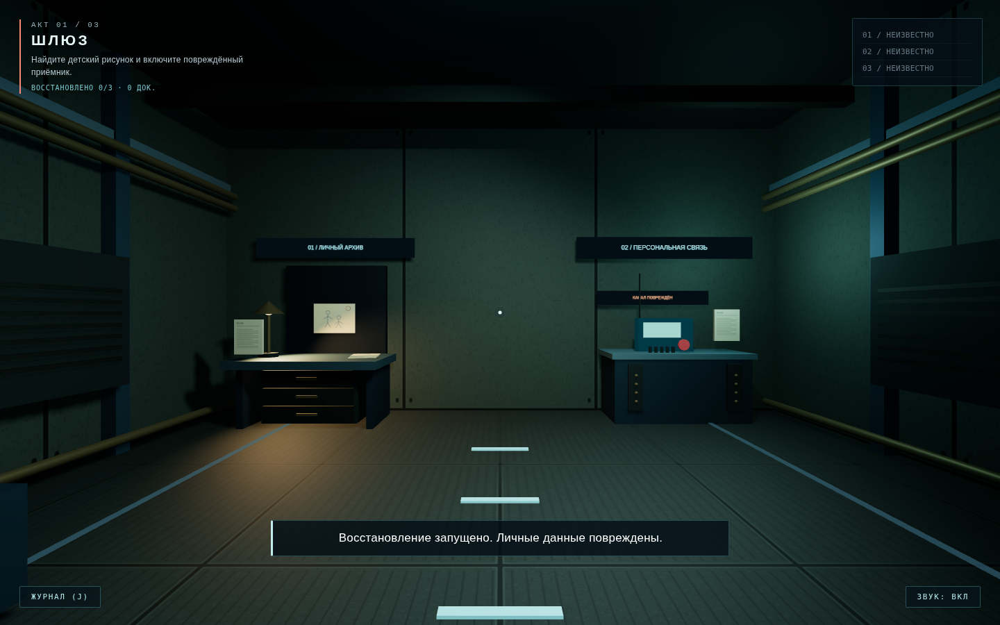

# ECHO — Три акта / сюжетная сборка

В этой версии полностью перестроена сюжетная структура с четырёх уровней на **три акта**. Оригинальная утверждённая вступительная кат-сцена перенесена без каких-либо правок аудио, изображения или анимации.

## Сюжет

- **Акт 1 / Шлюз.** Герой находит детский рисунок и включает повреждённый приёмник. В записи звучат **только голос дочери «Daddy?» через плохую радиосвязь и оригинальный звук взрыва**. Ответ героя в запись не входит. Для перехода нужны рисунок и прослушанная запись.
- **Акт 2 / Лаборатория.** Три документа подтверждают начало эвакуации жилого сектора до взрыва, повреждение списков спасённых и собственное решение инженера отложить аварийное отключение. Судьба семьи не установлена. Все три документа открывают фрагмент «Эвакуационный протокол».
- **Акт 3 / Капсула.** Герой находит игрушку и подходит к зеркалу, чтобы выбрать один из трёх вариантов. До игрушки зеркало не даёт завершить восстановление.

## Выбор перед зеркалом

- **Принять правду:** сохраняет воспоминания и признаёт личную ответственность.
- **Переписать историю:** удаляет память о причинной связи между решением и катастрофой; субъективно освобождает себя от вины, но реальное прошлое не меняется.
- **Начать сначала:** создаёт новую личность, отказывается от прежнего «я» и связи с семьёй.

При обычном прохождении у зеркала доступны все три выбора. Для перехода в третью часть нужно восстановить первые два фрагмента, а выбор у зеркала требует игрушку. **Герой ни в одной концовке не узнаёт, что произошло с дочерью.** Возможная реплика «Что же я натворил?» не добавлена.

## Изменения кода

- Переработаны структура `levels.js`, сюжет `story.js`, воспоминания `memory.js` и взаимодействия.
- Добавлен проигрыватель восстановленной радиозаписи `src/recording.js`. Использует существующие локальные MP3, повторно генерировать озвучку не нужно.
- Обновлён интерфейс: цель текущего акта, три фрагмента, документы, аудиоэкран, зеркало и три исхода.
- Удалён отдельный терминал вины: решение происходит только у зеркала.
- Исправлены состояния собираемых рисунка и игрушки и сохранения прогресса.
- Сохранения старого четырёхактного прототипа автоматически считаются несовместимыми. Ранее открытые финалы по возможности сохраняются. Рекомендуется начать новую игру.

## Как запускать на Windows 11

1. Распакуйте весь ZIP в обычную папку, например `Documents/ECHO`.
2. Запустите **`start_game_windows.bat`** двойным щелчком.
3. Откройте `http://localhost:8765/` в браузере, если он не открылся автоматически.
4. Нажмите «Начать» (новая игра) или «Продолжить».

Для BAT нужен установленный Python 3 (`py` или `python`). Файлы JS используют ES-модули, поэтому **не открывайте `index.html` напрямую через `file://`**. Three.js 0.160.0 включён в архив; для запуска интернет не требуется.

Управление: WASD/стрелки — движение, мышь — обзор (щёлкнуть по сцене для захвата курсора), E — взаимодействие, J — архив памяти, Escape — пауза. Есть экранное управление для устройств с сенсорным экраном.

## Состояние разработки

Это **цельная тестовая сборка трёхактного сюжета**, а не окончательно отполированная игра. Для концовок созданы стилизованные экраны, но отдельные 3D-видеокат-сцены для каждого финала ещё не разработаны. Нужна окончательная проверка поведения в обычном браузере Windows, звука, расстояний взаимодействия и баланса.

Автоматические проверки выполняются так:

```sh
npm test
```

Дополнительно JavaScript проверен командой `node --check`. Сквозная загрузка в headless-браузере в этой среде ограничена запретом на сетевую навигацию; это не равнозначно подтверждённому тесту на Windows.

Ни одна новая генерация Runway не запускалась; расходы кредитов — **0**.


## Исправление размещения игрушки и финального выбора
- Игрушка находится только в третьем акте «Капсула»; в первом и втором актах объектов типа `toy` нет.
- У зеркала отображаются все три варианта: «Принять правду», «Переписать историю», «Начать сначала». «Переписать историю» доступно всегда; два других варианта активируются после восстановления всех трёх фрагментов. В штатном прохождении игрушка — третий фрагмент, поэтому после её восстановления доступны все три выбора.
- Обновлён ключ сохранения на `echo_save_three_acts_v3`, чтобы старые сохранения прототипа не подмешивали прежнее расположение предметов и устаревшее состояние концовок.


## Детализация первого акта

Название меню: ECHO / RESTORATION INITIATED, по предоставленному образцу.
Шлюз дополнен кушеткой восстановления, архивным столом, станцией связи,
конструктивными рёбрами, кабельными трассами, указателями и напольной разметкой.
У мебели есть коллизии; центральный проход остаётся свободным.
На рисунке видны отец и дочь, держащиеся за руки, и красное солнце.
Сюжетные условия перехода и существующие аудиофайлы сохранены.


## Графика первого акта: свет и материалы



Холодное рассеянное освещение сочетается с тёплой рабочей лампой.
Добавлены мягкие тени, тональная коррекция ACES, фактурные панели
и металлический пол с рельефом. Текстуры генерируются локально.
Дополнены оборудование, трубы, вентиляция, ящики, бумажные документы
и поручни кушетки. Графическая доработка сосредоточена на первом акте.

Проверено в Chromium: загрузка сцены без ошибок JavaScript, доступность
рисунка, приёмника и двух документов, повторные переходы между актами.
После трёх циклов переходов количество геометрий и текстур не увеличилось.
Производительность на реальных мобильных устройствах пока не измерена.
